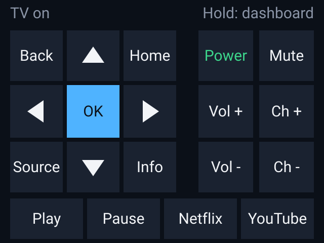

# Samsung TV Remote

[](https://github.com/baverrr/samsung-tv-remote-v2/actions/workflows/tests.yml)
[](https://github.com/baverrr/samsung-tv-remote-v2/actions/workflows/codeql.yml)

A desktop remote control for Samsung Tizen smart TVs (2016 and later), for Linux. It sends remote keys,
opens apps, turns the TV on and off, casts photos, videos and music from this PC, and mirrors the screen,
all over the local network. There's a Qt window for everyday use and a command line for scripts.

Built for and tested against a 2021 Samsung AU8000 (Tizen, firmware platform 21_KANTSU2E) on
Ubuntu 26.04 with KDE Plasma on Wayland.

<p align="center">
  
  &nbsp;&nbsp;
  
  &nbsp;&nbsp;
  
</p>

> [!IMPORTANT]
> **Disclaimer.** This is an independent project. It isn't made, endorsed, sponsored or
> supported by Samsung Electronics. "Samsung", "Tizen" and related names are trademarks of
> their owners, used here only to say which TVs the remote works with.
>
> - **Use at your own risk.** The remote is provided as is, without warranty (see the
>   [Terms and Conditions](TERMS.md)). Samsung can change its TVs' software at any time,
>   which may stop some or all features from working.
> - **Use it only with TVs you own or are allowed to control.**
> - **Cast or mirror only content you have the right to show.**

## Features

- **Remote keys:** d-pad, OK, Back, Home, Menu, volume, channel, mute, source, info and media keys, with
  keyboard shortcuts. Held keys repeat.
- **Apps:** five app buttons plus an **All apps** menu, both your choice (**All apps › Edit apps…**, or
  right-click an app button). It starts with Netflix, YouTube, Prime Video, Disney+ and Hulu on the remote
  and 15 more popular apps in All apps. You can add about 30 popular apps, or any app by its ID under Advanced.
  The TV is asked which of them it has, and the ones it doesn't have stay hidden.
- **Typing:** send text to the TV's on-screen keyboard, e.g. a search box.
- **Power:** off with confirmation (it checks the TV really went to standby, and presses again if the TV
  dropped the first key); on via Wake-on-LAN.
- **TV Cast:** play photos, videos, music or whole folders on the TV over DLNA, with a queue, seek bar,
  next/previous, pause and an optional photo slideshow. HEIC, WebP, GIF, TIFF and AVIF photos are converted
  to JPEG on the fly. Drag and drop files onto the cast window.
- **Screen mirroring:** opens GNOME Network Displays (Miracast). Share the whole screen or just one window,
  e.g. a browser: with the [patched build](#mirroring-one-window) you can resize the window or take a video
  full screen and the TV keeps playing, scaled to fit. A small background service sends the PC's sound to
  the TV while mirroring, but keeps chat and call apps (Discord, Zoom, Teams, …) on your headset.
- **Desktop integration:** a single window (launching again brings it forward), `tvremote://` links to open
  the remote or the cast window, and a "Cast Files to TV…" action in the app menu.
- **Command line:** every main action, scriptable.
- **ESP32 bridge:** `tv-remote serve` takes remote keys, app launches and power over plain HTTP, so an
  ESPHome device (e.g. a touch screen on the wall) can be a remote too. See [ESP32 bridge](#esp32-bridge).

## How it works

| What | How |
|---|---|
| Keys and text | WebSocket on `wss://TV:8002`, channel `samsung.remote.control`. The first connection shows an **Allow** prompt on the TV; the pairing token it returns is saved. |
| Apps | REST on `http://TV:8001/api/v2/applications/<id>`. 2021+ firmware ignores the WebSocket "installed apps" and "launch app" requests, so each known app ID is probed (404 = not installed) and apps are opened with a POST. |
| Power state | `http://TV:8001/api/v2/` reports `PowerState` (on / standby); no answer means off or unreachable. |
| Power on | Wake-on-LAN magic packet to the LAN broadcast address. |
| Casting | The TV's DLNA renderer (UPnP AVTransport on port 9197). A small HTTP server on this PC (port **8199**) serves the file that's playing, only to the TV's address, under an unguessable link that stops working as soon as the queue moves on. |
| ESP32 bridge | `tv-remote serve`: a small HTTP server on port **8198**. Each request needs a bearer token and goes through the same TV client as the window, so the pairing token, Wi-Fi fallback, app list and confirmed power-off are shared. |
| Mirroring | GNOME Network Displays (Miracast over Wi-Fi Direct): the patched build in `~/.local/opt/gnd` if there is one, otherwise the system copy. `mirror_audio.py` watches PipeWire (`pactl subscribe`) and routes app audio while a session is streaming. |

## Requirements

- Linux with Python 3.10 or newer and a desktop session. The tests run on Python 3.10–3.14 on every push;
  day-to-day use has only been on Python 3.14 with KDE Plasma (Wayland).
- Qt for Python (PySide6) from the distribution:
  `sudo apt install python3-pyside6.qtwidgets python3-pyside6.qtsvg`
- `websocket-client` (installed into a virtual environment below).
- Optional:
  - `ffmpeg`, to cast HEIC, WebP, GIF, TIFF and AVIF photos.
  - `gnome-network-displays`, for screen mirroring (and Docker, to build the patched copy that mirrors one
    window reliably).
  - `kdialog`, for start-up error pop-ups.
- The TV and this PC on the same LAN. Give the TV a fixed address (a DHCP reservation in the router).

## Install

```sh
git clone https://github.com/baverrr/samsung-tv-remote-v2.git ~/.local/share/tv-remote
cd ~/.local/share/tv-remote
./install.sh            # add --audio for sound on the TV while mirroring, --bridge for the ESP32 bridge
```

`install.sh` installs for the current user only and needs no root. It:

- creates `venv/` in the checkout, which also sees the distribution's PySide6, and installs `websocket-client`
  into it;
- installs the `tv-remote` launcher to `~/.local/bin`;
- adds the **TV Remote** menu entry, its "Cast Files to TV…" action and the `tvremote://` link handler;
- installs the app icon (`tvremote`);
- with `--audio`, installs and starts the `tv-mirror-audio` user service;
- with `--bridge`, installs and starts the `tv-remote-bridge` user service (see [ESP32 bridge](#esp32-bridge)).

The launcher and service point at the folder you ran the script from. If you move the checkout, run it
again. The templates it fills in are in `packaging/`.

### Mirroring one window

<p align="center">
  
</p>

GNOME Network Displays 0.99 freezes the TV picture and sound when a window you're sharing changes size,
which includes a video in it going full screen. `tools/build-gnd.sh` builds a copy with
`tools/gnd-window-resize.patch` applied and installs it to `~/.local/opt/gnd`; **Mirror screen** and
`tv-remote mirror` then use it instead of the system copy:

```sh
tools/build-gnd.sh      # needs Docker; builds the installed gnome-network-displays version
```

It builds in an Ubuntu container matching your release, so no development packages are installed on your
system. Run it again after `gnome-network-displays` is upgraded. To go back to the system copy, delete
`~/.local/opt/gnd`.

What the patch changes:

- **The fix:** the PipeWire screen capture no longer drives the stream's clock. That clock stops while the
  compositor switches the stream to a new window size, and everything timed by it (picture and sound)
  waited for it forever.
- Square pixels before the encoder, so a window of any shape is fitted with black bars instead of being
  stretched, and the encoder isn't restarted on every resize.
- The capture no longer pauses the whole stream while it waits for a first frame at the new size, and
  frames are copied out of PipeWire's buffers as they arrive.
- A keyframe (a full picture) every second. The stock build sends one only every 10 seconds when the TV
  says it can ask for one, so after a few packets are lost on Wi-Fi the picture can stay frozen or smeared
  for several seconds; now it recovers within a second.
- A crash when GNOME Network Displays closes (`free(): invalid pointer`) is fixed.

**Firewall:** if you use a default-deny firewall, let the TV reach the cast server (`<TV address>` is your
TV's IP):

```sh
sudo ufw allow from <TV address> to any port 8199 proto tcp
```

### Updating

```sh
git -C ~/.local/share/tv-remote pull
```

Close and reopen the remote afterwards (launching it again only brings the open window forward). If
`gnome-network-displays` was upgraded, also run `tools/build-gnd.sh` from the checkout again.

## Setup

Settings live in `~/.config/tv-remote/config.json`. Create it with your TV's details; the remote adds the
pairing token and the app list to it, and saves it readable only by you:

```json
{
  "host": "192.168.1.50",
  "mac": "aa:bb:cc:dd:ee:ff",
  "name": "Linux Remote"
}
```

- **`host`:** the TV's IP address.
- **`mac`:** the TV's MAC address, used for Wake-on-LAN.
- **`name`:** what the TV calls this remote.

Until `host` is set, the remote says so instead of starting.

**If the TV moves to Wi-Fi** (its cable is out, or it was switched over), the remote finds it there by
itself. Once it has reached the TV, it saves the TV's ID (`tv_id`), Wi-Fi MAC (`wifi_mac`) and Wi-Fi
address (`wifi_host`). When the TV doesn't answer at `host`, it tries `wifi_host`. If that fails too, it
checks every address on the LAN for a TV with that ID, at most every 30 seconds. `host` stays your wired
address, so the remote goes back to it when the cable is back in. Power-on sends the wake packet to both MACs.

On the first connection the TV asks to **Allow** the remote. If you denied it, allow it under
Settings › General › External Device Manager › Device Connection Manager.

For power-on, enable Settings › General › Network › Expert Settings › **Power On with Mobile**.

Your app choices are saved in the same file: `favorites` (the remote's buttons, in order), `menu_apps`
(All apps) and `custom_apps` (apps added by ID). The **Edit apps** window is the easy way to change them.

Chat apps kept off the TV while mirroring are listed in `~/.config/tv-remote/mirror-audio.json`. It's
created with defaults (Discord, Zoom, Teams, Slack, Signal, …) and re-read while mirroring, so edits
apply without a restart.

## Usage

### Window

Open **TV Remote** from the app menu, or run `tv-remote`. `tvremote://open` and `tvremote://cast` links open
the remote, or the remote and the cast window.

| Key | Action |
|---|---|
| Arrow keys | Move |
| Enter | OK |
| Esc or Backspace | Back |
| H | Home |
| + / − | Volume |
| M | Mute |
| Page Up / Down | Channel |
| Space / P | Pause / Play |
| [ / ] | Rewind / Fast-forward |
| S | Source |
| I | Info |
| T | Type text |
| Tab | Move between on-screen keys |
| F11 | Full screen |
| ? | List the shortcuts |

### Command line

```sh
tv-remote key volup mute            # keys, short (volup) or full (KEY_VOLUP) names
tv-remote apps                      # installed apps and their IDs (★ = on the remote)
tv-remote launch netflix            # open an app (exact name first, then partial)
tv-remote text "stranger things"    # type into the TV's on-screen keyboard
tv-remote on | off                  # power
tv-remote info                      # the TV's device details (JSON)
tv-remote cast ~/Pictures/Trip      # cast files or folders; Ctrl+C stops
tv-remote mirror                    # start screen mirroring
tv-remote serve                     # run the ESP32 bridge (port 8198); --token prints its token
```

Errors come back as one line saying what failed, e.g. "Couldn't reach the TV at …" or "Netflix isn't
installed on the TV any more".

### Mirroring tips

- **Whole screen or one window:** the screen-sharing prompt (KDE's or GNOME's) decides what the TV shows.
  Pick a screen to mirror everything, or a window (e.g. your browser) to show only that. A shared window
  keeps streaming while it's covered by other windows or minimized.
- **"Error" when connecting:** the TV may still be holding a previous mirroring session. Press **Home** on
  the TV (or switch source), then pick it again; restarting the TV clears a stuck Wi-Fi Direct session.
  Several TVs can show up in the list, so check you picked the right one.
- **Choppy picture:** first check the signal to the TV. The PC talks to the TV directly, not through your
  router, so a weak signal (worse than about -70 dBm) makes the picture freeze now and then, and the TV may
  drop the connection. While mirroring:

  ```sh
  for i in $(iw dev | awk '/Interface p2p-/{print $2}'); do iw dev "$i" station dump | grep 'signal:'; done
  ```

  Around -60 dBm is good. If it's weaker, move the PC closer to the TV or out from behind things in the way.

  Wi-Fi power saving on this PC's Wi-Fi card also makes the radio doze, and the TV link shares that radio.
  To turn it off for good with NetworkManager:

  ```sh
  printf '[connection]\nwifi.powersave = 2\n' | sudo tee /etc/NetworkManager/conf.d/zz-wifi-powersave-off.conf
  sudo nmcli general reload conf
  ```

  It applies the next time Wi-Fi reconnects. To undo, delete that file and reload again.

  Some Wi-Fi drivers have power saving of their own that this doesn't reach. Realtek cards on the `rtw89`
  driver (e.g. the RTL8852BE) stall for a moment now and then, which shows as a freeze on the TV, and log
  `timed out to flush queues` (`journalctl -k`). To turn their power saving off:

  ```sh
  printf 'options rtw89_core disable_ps_mode=y\noptions rtw89_pci disable_aspm_l1=y disable_aspm_l1ss=y disable_clkreq=y\n' | sudo tee /etc/modprobe.d/rtw89-no-powersave.conf
  ```

  It applies after a reboot. To undo, delete that file and reboot. The [patched build](#mirroring-one-window)
  also gets the picture back within a second after a stall, instead of up to 10.

## ESP32 bridge

<p align="center">
  
</p>

Microcontrollers like the ESP32 can't easily keep the TV's TLS WebSocket open. `tv-remote serve` gives
them plain HTTP on the LAN instead and does the TV side itself:

| Request | Does |
|---|---|
| `POST /key/<key>` | Sends a remote key: `volup` or `KEY_VOLUP` |
| `POST /launch/<app>` | Opens an installed app by key (`netflix`) or by the TV's name for it (URL-encoded) |
| `POST /power/on` | Wake-on-LAN. Answers at once (`202`) |
| `POST /power/off` | Presses power until the TV reports standby, in the background (`202`); pressing again meanwhile does nothing |
| `GET /status` | `{"power": "on"}`, `"standby"` or `"off"` |

Replies are JSON: `{"ok": true, ...}`, or `{"error": "..."}` with `400` (bad key name), `401` (token),
`403` (address not allowed), `404` (unknown request or app) or `502` (the TV didn't answer or refused).

**Set it up:**

1. Run `./install.sh --bridge`. This starts the `tv-remote-bridge` user service
   (`journalctl --user -u tv-remote-bridge` for its log).
2. Get the token with `tv-remote serve --token`. It's generated into `config.json` (`bridge_token`) the
   first time. Every request needs the header `Authorization: Bearer <token>`.
3. Optionally, limit which devices can connect. In `config.json`, `"bridge_clients": ["192.0.2.30"]`
   allows only those addresses, and `"bridge_listen"` picks the address to listen on (default: all).
4. With a default-deny firewall, let the device reach the port:

   ```sh
   sudo ufw allow from <ESP32 address> to any port 8198 proto tcp
   ```

The token travels unencrypted, like everything on plain HTTP. That's fine on a home LAN, but don't
forward the port to the internet.

**An ESPHome example:**

```yaml
http_request:
  timeout: 3s

script:
  - id: tv_send
    mode: queued
    parameters:
      path: string
    then:
      - http_request.post:
          url: !lambda return std::string("http://192.0.2.10:8198") + path;
          request_headers:
            Authorization: "Bearer change-me"

button:
  - platform: template
    name: TV Volume Up
    on_press:
      - script.execute: {id: tv_send, path: /key/volup}
```

The touch remote in the picture above is a "Cheap Yellow Display" (ESP32-2432S028R) build. It also
sends the IR power code (`remote_transmitter.transmit_samsung: {data: 0xE0E040BF}`) through an IR LED,
which turns on TVs that ignore Wake-on-LAN.

## Project layout

| File | What it is |
|---|---|
| `tv_remote.py` | TV client (WebSocket keys, REST apps and power, Wake-on-LAN), config, CLI, entry point |
| `remote_qt.py` | The Qt (PySide6) remote and cast windows, design tokens and stylesheet |
| `cast.py` | DLNA casting: the file server, the renderer client and the play queue |
| `bridge.py` | The ESP32 bridge: `tv-remote serve`'s HTTP server |
| `mirror_audio.py` | PipeWire audio routing while mirroring (standard library only, runs as a user service) |
| `test_gui.py`, `test_bridge.py`, `test_mirror_audio.py` | Tests (the TV and PipeWire are faked; nothing touches the network) |
| `install.sh`, `packaging/` | Per-user install: launcher, menu entry, icon, audio and bridge service templates |
| `tools/screenshots.py` | Re-renders the screenshots in `docs/` offscreen |
| `tools/build-gnd.sh`, `tools/gnd-window-resize.patch` | Builds GNOME Network Displays patched for one-window mirroring |
| `docs/` | README screenshots (`*.png`), the mirroring diagram (`mirroring.svg`) and the ESP32 remote screen (`esp32-remote.svg`) |
| `icons/` | Lucide icons used by the windows |
| `tv-remote.svg` | App icon |

## Development

```sh
./venv/bin/pip install pytest pytest-qt ruff   # once
QT_QPA_PLATFORM=offscreen ./venv/bin/python -I -m pytest -q
./venv/bin/ruff check .
pyright                                        # uses pyrightconfig.json
```

The tests run offscreen (no windows appear) against stubs, so they never talk to a real TV or change your
audio, and they use a temporary config.

## Known limitations

- **Wake-on-LAN is unreliable on some models.** On the AU8000 it's tested on, the TV drops off the network in
  standby and ignores magic packets, so turning it on usually needs the physical remote, or an IR LED on
  an [ESP32 remote](#esp32-bridge).
- **App IDs come from community lists.** Samsung doesn't publish them, and some apps have a different ID on
  2020 and later TVs. `CATALOG` in `tv_remote.py` lists every ID known for each app, and the TV is asked which
  one it has, so a wrong ID only means the app shows as "Not on this TV". Apps outside the catalog can be
  added by ID (Edit apps › Add apps… › Advanced) once the TV confirms it has them.
- **No volume over DLNA:** the renderer's own volume isn't the TV's real volume, so casting uses the remote's
  VOL keys instead.
- **Casting needs the remote running:** files stream from this PC, so closing the remote stops casting.
- **One-window mirroring needs the patched build:** the system GNOME Network Displays freezes when a shared
  window is resized (see [Mirroring one window](#mirroring-one-window)). Whole-screen mirroring works with
  either.
- **One TV:** settings hold a single TV.

## Privacy and terms

The remote collects nothing and talks only to your TV on your own network. What it keeps on your
computer, and what goes over the network, is in the [Privacy Policy](PRIVACY.md). Use of the app
is covered by the [Terms and Conditions](TERMS.md).

## Credits

Icons are from [Lucide](https://lucide.dev) (ISC License; see `icons/LICENSE-lucide`).
